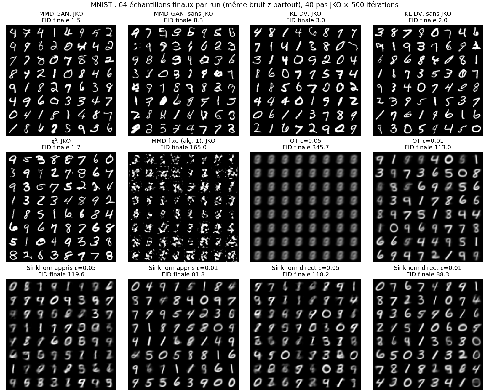
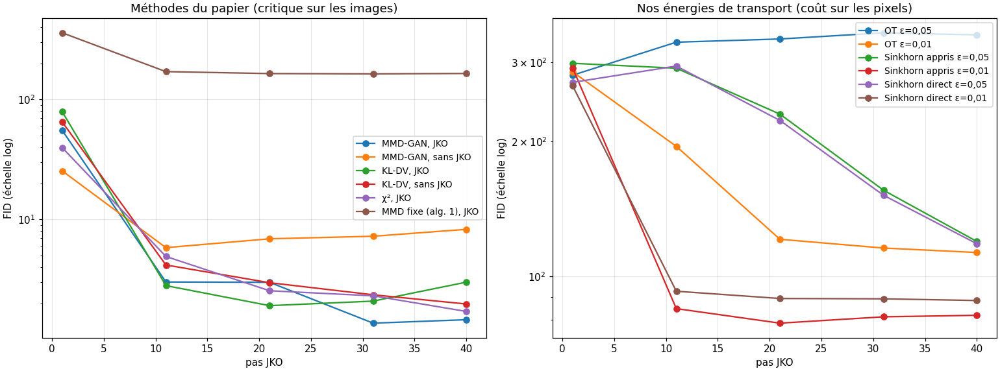

# MNIST : nos énergies dans le code du papier

On reprend le code de Caucheteux, Bonet et Korba
([Generative_Wasserstein_Flows](https://github.com/Paulcauch/Generative_Wasserstein_Flows), commit 6633b55)
et on y ajoute nos énergies 2D, sans changer le reste (architecture ResNet-MMD de leur Table 1,
schéma JKO, optimiseurs).

## Contenu

| Fichier | Rôle |
|---|---|
| `energies_nous.py` | OT ε, Sinkhorn appris, Sinkhorn direct, MMD fixe (mêmes formules qu'en 2D) |
| `gwf.patch` | Modifications de leur `train.py`, marquées `[nous]` |
| `kaggle_mnist.py` | Liste des runs et lancement sur des comptes Kaggle (2 runs par noyau T4 ×2) |
| `figures.py` | Résumé JSON et figures à partir des sorties Kaggle |
| `resultats/n1.json` | FID au fil des pas JKO et temps de calcul, pour les 12 runs |
| `figures/` | Échantillons finaux et courbes de FID |

## Énergies ajoutées

Les images sont aplaties puis divisées par √d : le coût c(x, y) = ½‖x − y‖² est alors celui de la
métrique du terme JKO du dépôt (moyenne sur les coordonnées).

- `OT_eps` : semi-dual entropique, un critique g, c-transformée calculée exactement sur le lot.
- `Sinkhorn_appris` : divergence de Sinkhorn par sa formulation variationnelle, deux critiques séparés g et s.
- `Sinkhorn_direct` : divergence de Sinkhorn calculée par l'algorithme de Sinkhorn sur chaque lot,
  gradient d'enveloppe, aucun critique.
- `MMD_fixe` : (1/2) MMD² de Riesz sur les images (algorithme 1 du papier).

KL_DV, chi2 et MMD (MMD-GAN à noyau appris) sont le code du dépôt, inchangé.
Options ajoutées : `--eps_sinkhorn`, `--tol_sinkhorn`, `--iter_sinkhorn`, `--budget_heures`
(arrêt propre, avec une dernière FID, avant la limite de 12 h de Kaggle). Les statistiques Inception
des vraies images sont calculées une seule fois au lieu de l'être à chaque évaluation.

## Installation

```bash
git clone https://github.com/Paulcauch/Generative_Wasserstein_Flows.git gwf
cd gwf && git checkout 6633b55 && git apply ../gwf.patch && cp ../energies_nous.py . && cd ..
```

## Lancer

```bash
python kaggle_mnist.py plan --run-id n2
KAGGLE_SANS_GPU=compte1 python kaggle_mnist.py push --run-id n2
python kaggle_mnist.py status --run-id n2
python kaggle_mnist.py pull --run-id n2
python figures.py --run-id n2
```

## Run n1

40 pas JKO × 500 itérations (20 000 mises à jour du générateur), lots de 256, τ = 0,5, un pas de
critique par pas de générateur, Adam 2e-4 / 1e-4, sans EMA, une graine. C'est un budget réduit :
leur Table 1 utilise 100 × 1 000. FID calculée sur 50 000 échantillons, GPU T4.

| Run | FID finale | s / itération | Durée totale |
|---|---|---|---|
| MMD-GAN, JKO | 1,5 | 0,88 | 5 h 11 |
| χ², JKO | 1,7 | 0,88 | 5 h 13 |
| KL-DV, sans JKO | 2,0 | 0,74 | 4 h 26 |
| KL-DV, JKO | 3,0 | 0,81 | 4 h 49 |
| MMD-GAN, sans JKO | 8,3 | 0,87 | 5 h 11 |
| Sinkhorn appris ε=0,01 | 81,8 | 1,25 | 7 h 17 |
| Sinkhorn direct ε=0,01 | 88,3 | 0,46 | 2 h 51 |
| OT ε=0,01 | 113,0 | 0,75 | 4 h 31 |
| Sinkhorn direct ε=0,05 | 118,2 | 0,41 | 2 h 34 |
| Sinkhorn appris ε=0,05 | 119,6 | 1,10 | 6 h 24 |
| MMD fixe, JKO | 165,0 | 0,42 | 2 h 38 |
| OT ε=0,05 | 345,7 | 0,79 | 4 h 42 |



